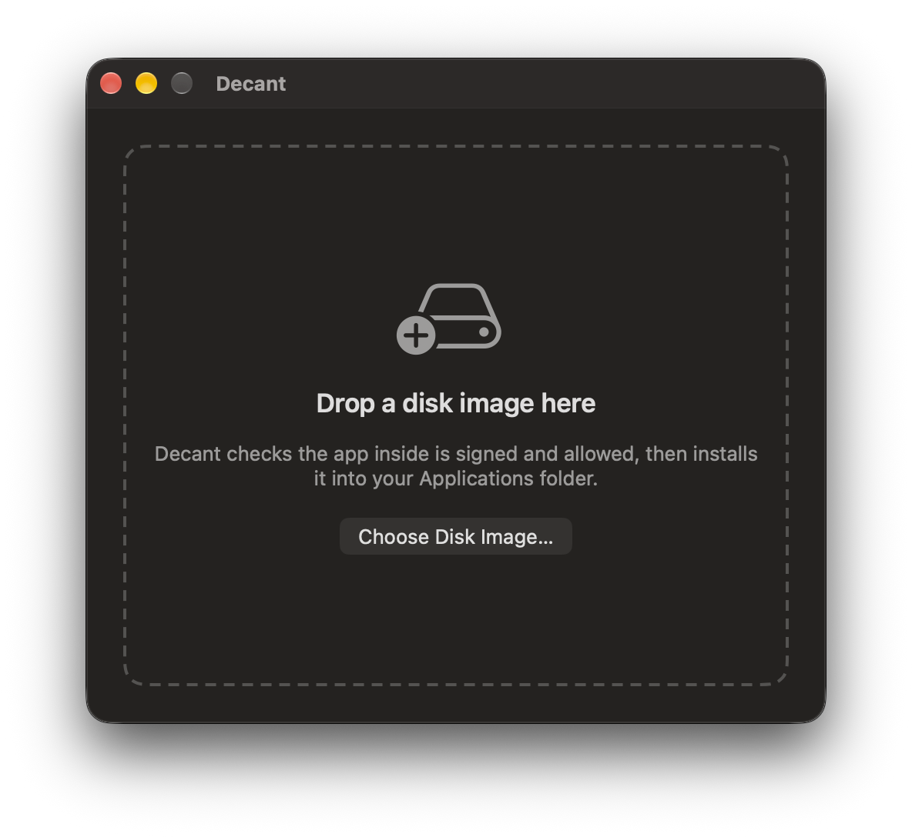
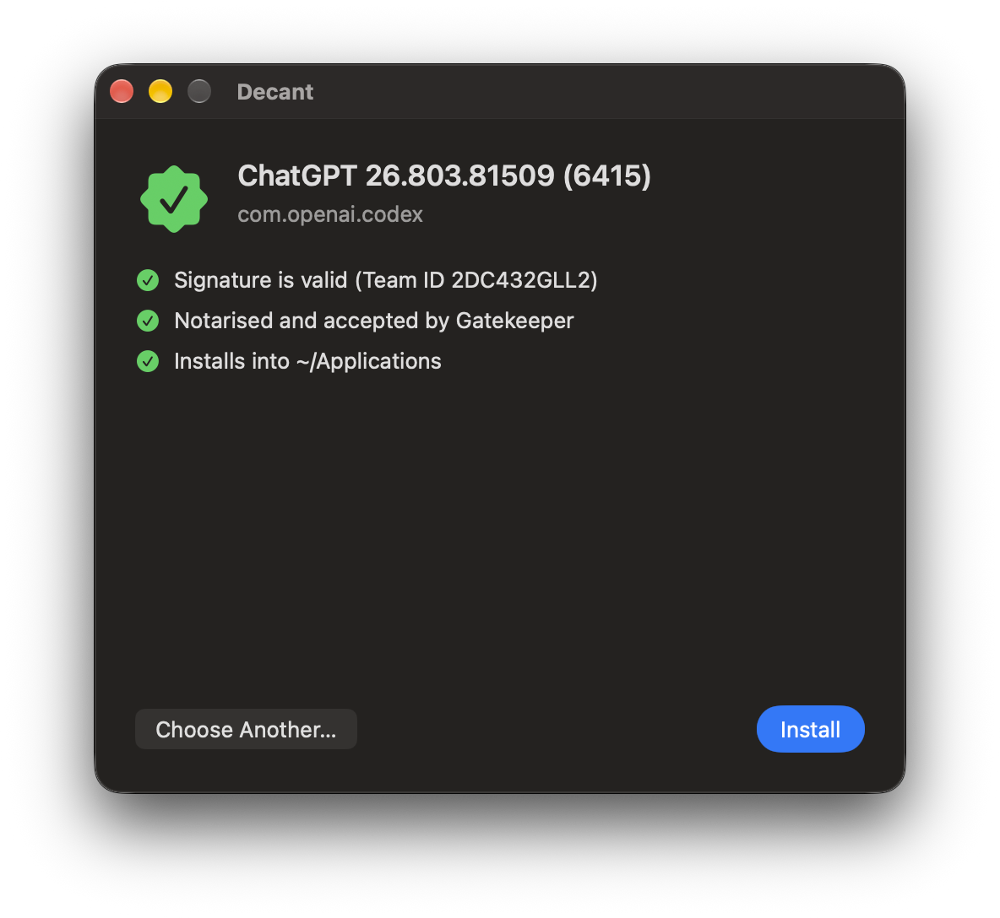

# decant

decant installs apps from vendor disk images (DMGs) for users who aren't admins, on Macs running
macOS 26 or later with Apple silicon. You give your MDM (Intune, Jamf, Kandji, …) the vendor's
DMG, and decant copies the app into the user's own `~/Applications` folder. You don't need to
repackage anything as a `.pkg`, and users don't need admin rights.

Before installing, decant checks that the app is signed, notarized and from the vendor you
expect. If anything looks wrong, it installs nothing and exits with a code that says why. It
never shows the user a prompt.

decant also comes with **Decant.app**, so users can install a DMG themselves with the same checks.
You can turn that off.

- [Getting started](#getting-started)
- [Installing an app](#installing-an-app)
- [Settings](#settings)
- [Decant.app](#decantapp)
- [Updates to decant](#updates-to-decant)
- [Troubleshooting](#troubleshooting)
- [Exit codes](#exit-codes)
- [Things to know](#things-to-know)
- [Removing decant](#removing-decant)

## Getting started

Download the latest packages from [Releases](https://github.com/BenStreet365/decant/releases).
There are two:

| Package | Installs |
|---|---|
| `decant-full-<version>.pkg` | The `decant` command, Decant.app, and automatic updates |
| `decant-cli-<version>.pkg` | The `decant` command and automatic updates, without Decant.app |

Then set it up in four steps. The examples use Intune; other MDMs have the same options under
different names.

1. **Deploy one of the packages** to your Macs. In Intune: Apps → macOS → line-of-business app.
2. **Deploy the configuration profile.** Edit
   [`Profiles/uk.street365.decant.mobileconfig`](Profiles/uk.street365.decant.mobileconfig) to suit
   (see [Settings](#settings)), then upload it. In Intune: Devices → Configuration → Templates → Custom.
   The defaults are safe, so you can deploy it unchanged.
3. **Deploy the App Management profile.** macOS 26 and later only let an app update another app if
   it has App Management permission, even in the user's own `~/Applications`. Without it, updating
   an app that is already installed fails with exit 44.
   Upload [`Profiles/uk.street365.decant.app-management.mobileconfig`](Profiles/uk.street365.decant.app-management.mobileconfig)
   the same way; it is ready to deploy for official releases (Team ID `Y633696656`). This covers
   Decant.app. When your MDM runs `decant`, macOS checks your MDM agent's permission instead. Most
   agents already have it; if yours doesn't, add the agent to the same profile. This is still a
   privacy (PPPC) profile on macOS 27.
4. **Add a script for each app** you want to deploy (see [Installing an app](#installing-an-app)).

## Installing an app

Start from [`Scripts/intune-install-from-url.sh`](Scripts/intune-install-from-url.sh). Make one
copy per app and fill in the top of it:

| Setting | What to put |
|---|---|
| `DMG_URL` | The vendor's download link. Must be HTTPS. |
| `EXPECTED_TEAM_ID` | **Required.** The vendor's Apple Team ID (see below). |
| `EXPECTED_BUNDLE_ID` | Recommended. The app's bundle ID, e.g. `com.example.app`. |
| `DMG_SHA256` | Optional. Pins one exact download, so you'd have to update it with every vendor release. Usually not needed. |

To find the Team ID and bundle ID, install the app on a test Mac and run:

```bash
decant check-app /Applications/Example.app
```

The Team ID matters because a download link can change. If the vendor's site is ever
compromised, the Team ID check stops decant from installing someone else's app from that link.

In Intune, add the script under Devices → macOS → Shell scripts, with **Run script as signed-in
user** set to **No**, since decant needs to run as root. Set a retry count, because some failures
just mean "try later" (exit codes 11, 40 and 43; see [Exit codes](#exit-codes)).

The app goes to the user logged in at the Mac. If nobody is logged in, the script exits 11 and
Intune retries later.

**What happens to existing copies:**

- An older version is replaced with the new one.
- The same version is left alone, so re-running a script is harmless.
- A newer version is left alone (exit 41) unless you turn on `AllowDowngrade`.
- If the app is open, the install waits for a later retry by default (exit 40). You can change
  this with `RunningAppBehavior`.
- A different app with the same name is never overwritten (exit 42).

**DMGs decant won't install:** anything that isn't a plain drag-and-drop image with one app in
it. That includes a `.pkg` inside a DMG, an "Install Example.app" installer, several apps, or extra
folders and scripts. These exit 21 and nothing is changed. Deploy them the usual way instead.

### Other ways to run it

For scripts on other MDMs, or for testing on a Mac yourself:

```
sudo decant install Example.dmg --expect-team-id ABCDE12345 [--expect-bundle-id com.example.app]
```

| Option | Does |
|---|---|
| `--dry-run` | Runs every check and reports what would happen, without installing. |
| `--all-users` | Installs for every local user account, not just the logged-in one. Each user gets their own copy. Users who aren't logged in see the app the next time they log in. |
| `--user <name>` | Installs for one named account. Only allowed if `AllowUserOption` is on. |
| `--json` | Prints a JSON report instead of the `RESULT` line. |

Other commands:

```
decant check-app <path.app>      # show an app's Team ID, bundle ID and signature
decant show-config               # show the settings decant is using on this Mac
sudo decant update --latest      # update decant to the newest version now (see Updates to decant)
sudo decant uninstall            # remove decant (see Removing decant)
```

## Settings

All settings come from a configuration profile for the preference domain `uk.street365.decant`.
Users can't change them. Leave a setting out to get its default.

**Security checks.** The defaults are the safe choice. Only change these if you know you need to.

| Key | Type | Default | What it does |
|---|---|---|---|
| `RequireGatekeeperAssessment` | bool | `true` | Only install apps that macOS Gatekeeper accepts as notarized by Apple (exit 23 otherwise). Also refuses if Gatekeeper is turned off on the Mac. |
| `AllowAdHocSignatures` | bool | `false` | Allow apps with no real signature. **For testing only.** Otherwise they're refused (exit 22). |
| `AllowedTeamIdentifiers` | [string] | empty | If set, only apps from these vendors' Team IDs can be installed on the Mac at all, by any script or user (exit 24 otherwise). |

**Install behaviour.**

| Key | Type | Default | What it does |
|---|---|---|---|
| `RunningAppBehavior` | string | `Skip` | What to do if the app is open: `Skip` (exit 40 and retry later), `Replace` (swap it in underneath; the user gets the new version next time they open it) or `Terminate` (quit the app first). |
| `AllowDowngrade` | bool | `false` | Allow replacing a newer installed version with an older one. |
| `AcceptLicenseAgreements` | bool | `false` | Accept a licence agreement built into the DMG on the user's behalf. Otherwise such DMGs are skipped. Check your organisation is allowed to do this. |
| `AllowUserOption` | bool | `false` | Allow `decant install --user <name>`. Only works in a device profile. |
| `LogFilePath` | string | `/Library/Logs/decant.log` | Where to write the log. |

**Decant.app and users.**

| Key | Type | Default | What it does |
|---|---|---|---|
| `AllowUserInstalls` | bool | `true` | Let users install apps themselves with Decant.app or `decant install`. Set to `false` to allow only your MDM to install apps. Decant.app then tells users it's been disabled by their administrator, and quits. |
| `ShowInMenuBar` | bool | not set | Decant.app stays in the menu bar when its window is closed (`true`) or never does (`false`). Leave it out to let users choose. |
| `OpenAtLogin` | bool | not set | Decant.app opens at login (`true`) or never does (`false`). Leave it out to let users choose. |
| `AutomaticUpdates` | bool | not set | Keep decant itself up to date (`true`) or never update it (`false`). Leave it out to let users choose; it's on by default. See [Updates to decant](#updates-to-decant). |
| `UpdateDeferralDays` | integer | not set | How many days after a release to wait before installing it, from 0 to 14. Leave it out to let users choose; it's 7 by default. |

**Device and user profiles.** You can deploy the profile to devices, to users, or both. A setting
in a device profile always wins, so to let user profiles decide a setting, leave it out of the
device profile. The sample profile sets most keys, so user profiles have no effect on those until
you remove them from it.

Run `decant show-config` on a Mac to check which settings it's using and which profiles it read.

## Decant.app

Decant.app lets users install a DMG themselves, with no MDM and no admin rights. They drop a DMG
on the window, or use **Open With → Decant** in Finder. Decant runs every check `decant install`
does and shows the app, its version and its vendor. It only offers **Install** if everything
passes; otherwise it says why. Afterwards it offers to move the DMG to the Trash.

<p>
  
  
</p>

Users can only install into their own `~/Applications`, which they could already do by dragging
the app in Finder, and your settings still apply. Set `AllowUserInstalls` to `false` if you don't
want users installing apps this way, or deploy the `decant-cli` package so Decant.app isn't
installed at all.

## Updates to decant

decant keeps itself up to date from this repository's
[releases](https://github.com/BenStreet365/decant/releases). This is about decant itself, not the
apps it installs.

- It checks GitHub once a day.
- It waits until a release is 7 days old (`UpdateDeferralDays`), so a bad release can be pulled
  before it reaches your Macs.
- It waits until the Mac is idle: nobody logged in, or no keyboard or mouse use for 10 minutes.
- It only installs a package signed and notarized by the same developer as the copy already
  installed, and never installs an older version.
- A Mac with the `decant-cli` package never gets Decant.app from an update.

Users can install the newest version straight away with **Check for Updates** in Decant.app's
Help menu (or its menu bar menu), or with `decant update --latest` in Terminal. They don't need
admin rights, and it skips the wait after a release and the idle wait. It never goes past your
profile: with `AutomaticUpdates` set to `false` it installs nothing, and with `UpdateDeferralDays`
set it still waits that long. The same package checks apply.

If you'd rather deploy new versions through your MDM, set `AutomaticUpdates` to `false`.
`decant update --check` shows whether an update is available. `sudo decant update` installs it
now, still following the deferral and idle rules, and `sudo decant update --latest` installs the
newest release now whatever your settings.

## Troubleshooting

**Where to look:**

- The script's output in your MDM ends with a line like
  `RESULT updated exit=0: Updated Foo.app from 1.2 to 1.3 at /Users/alex/Applications/Foo.app`.
- The full log is at `/Library/Logs/decant.log` on the Mac. For Decant.app, it's
  `~/Library/Logs/decant.log` in the user's home folder.
- decant also writes to the unified log, under subsystem `uk.street365.decant`.

**Common problems:**

| Exit | Problem | Fix |
|---|---|---|
| 11 | Nobody logged in | Normal. Intune retries later. Use `--all-users` if the app should be there before anyone logs in. |
| 21 | Not a drag-and-drop DMG | The vendor ships an installer. Deploy it as a package instead. |
| 23 | Gatekeeper rejected the app | The app isn't notarized, or Gatekeeper is turned off on the Mac. Check with `spctl --assess -v /path/to/App.app`. |
| 24 | Wrong Team ID | Run `decant check-app` on the app and compare the result with `EXPECTED_TEAM_ID`. Vendors do occasionally change Team IDs. |
| 40 | App was open | Normal. Intune retries later. Or set `RunningAppBehavior`. |
| 41 | A newer version is installed | The user's copy has updated itself past the DMG version. Nothing to do. |
| 44 | macOS blocked the update (App Management) | Deploy the App Management profile (see [Getting started](#getting-started)). For Decant.app on one Mac, an admin can turn on Decant in System Settings → Privacy & Security → App Management. If `decant` was run by your MDM or in Terminal, it's that app that needs the permission. |

If `decant` itself refuses to start with exit 1, check `/Library/Logs/decant.log`. The usual cause
is that `/usr/local/bin` is owned by a user (old Homebrew installs did this), which would let that
user replace a tool that runs as root. Fix the folder's ownership with
`sudo chown root:wheel /usr/local/bin`.

## Exit codes

Your scripts can rely on these; they won't change.

| Code | Meaning |
|---|---|
| 0 | Installed, updated, already up to date, or dry run OK |
| 1 | Unexpected error, or decant is installed somewhere a non-root user could replace it |
| 10 | Not allowed: `--user` without `AllowUserOption`, user installs turned off with `AllowUserInstalls`, or a root-only option used without root |
| 11 | Nobody logged in (retry later), unknown or system user, or no user accounts for `--all-users` |
| 20 | DMG missing, failed to download, couldn't be opened, or already open somewhere else (eject it in Finder and retry) |
| 21 | Not a simple drag-and-drop DMG; nothing done |
| 22 | App not properly signed |
| 23 | Rejected by Gatekeeper |
| 24 | Team ID not allowed, or not the expected one |
| 25 | Bundle ID not the expected one, or (in Decant.app) the DMG changed after it was checked |
| 40 | App is open and `RunningAppBehavior` is `Skip` (retry later) |
| 41 | A newer version is already installed |
| 42 | Something else is in the way at the destination |
| 43 | Another install was still running after 30 minutes (retry later) |
| 44 | macOS didn't allow replacing the installed app: whatever ran decant needs App Management permission |
| 50 | Install failed |
| 51 | `uninstall` couldn't remove everything |
| 52 | `update` couldn't check for, download or install a new version |
| 64 | Wrong command-line options |

## Things to know

Installing apps into each user's own folder is what makes decant work without admin rights, and
it has costs:

- **Users own their copy.** They can delete it, move it or break it. Redeploying installs it again.
- **Apps can update themselves.** Most apps' built-in updaters work without admin rights, which is
  usually what you want. It also means the version on a Mac can be newer than the one you
  deployed. decant never rolls an app back.
- **The app is writable by the user**, so malware running as that user could tamper with it. A
  root-owned copy in `/Applications` prevents that. decant's checks only happen at install time.
- **One copy per user.** With `--all-users`, each account has its own copy, using its own disk space.
- **No "downloaded from the internet" prompt.** decant removes quarantine after its checks, which
  also skips macOS's own scan on first launch. Keep `RequireGatekeeperAssessment` on so the app
  still has to be notarized.

For how decant protects itself and the Mac while running as root, see
[docs/SECURITY.md](docs/SECURITY.md).

## Removing decant

```bash
sudo decant uninstall
```

This removes the `decant` command, Decant.app, the update service, logs and settings for every
user. It doesn't remove apps decant installed. Add `--dry-run` to see what it would remove first.
Remove the configuration profile from your MDM separately.

To switch a Mac from the full package to `decant-cli`, uninstall first. Otherwise Decant.app stays
behind and updates keep installing the full package.

## Building from source

See [docs/DEVELOPMENT.md](docs/DEVELOPMENT.md).

## Licence

decant is open source under the [Apache License 2.0](LICENSE). You can use it, change it and
deploy it in your organisation for free.

"Decant" and the Decant logo are not covered by the licence. If you publish a modified version,
give it a different name and icon so admins can tell it apart from official releases.
